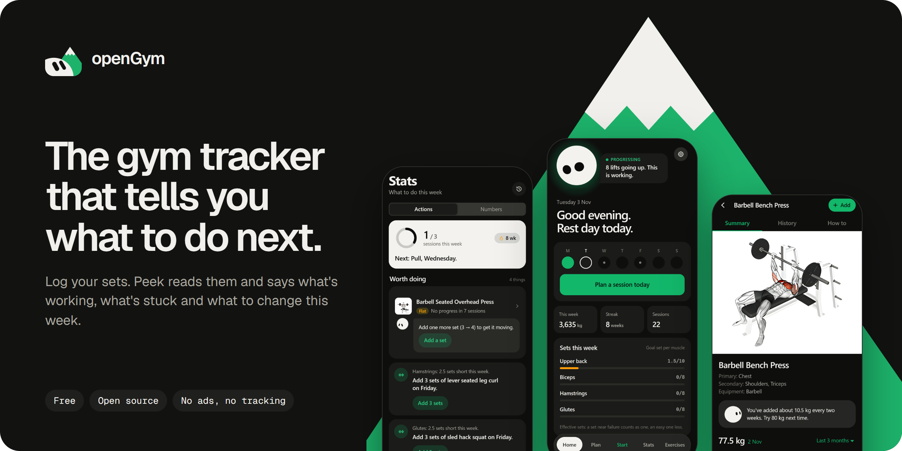
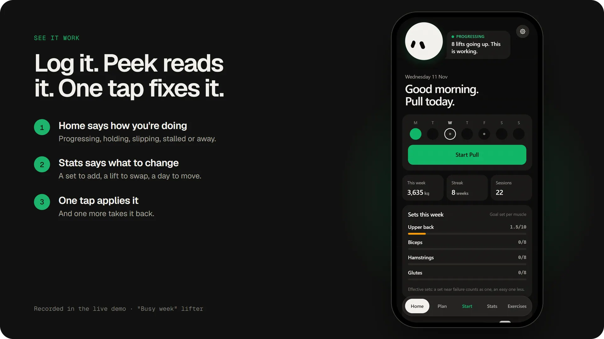
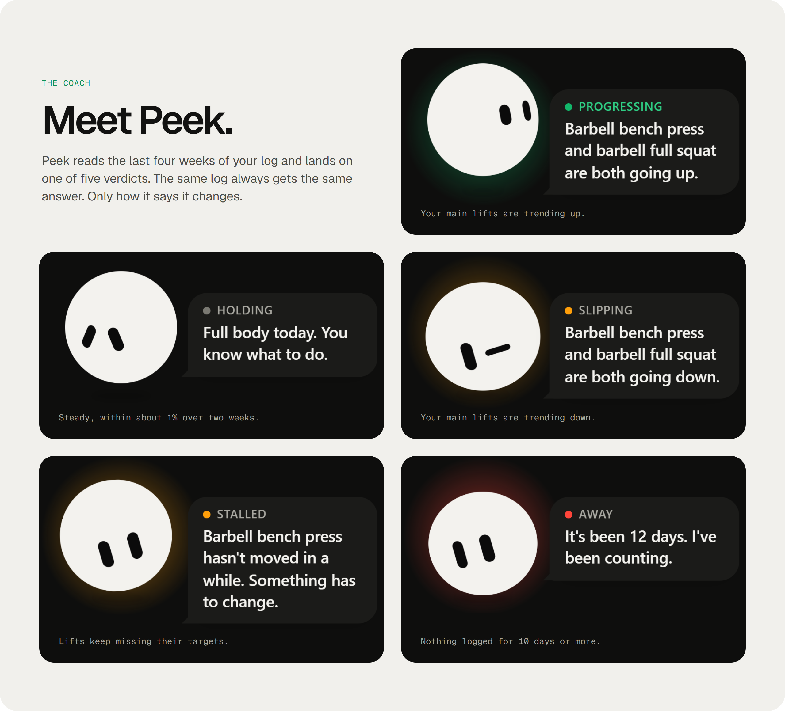
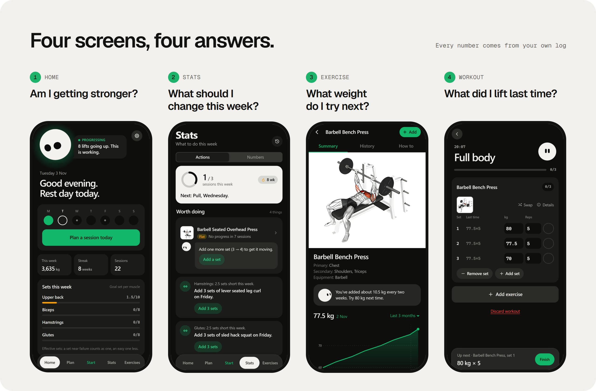
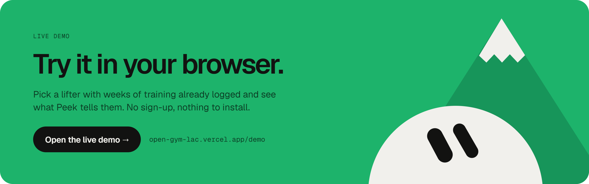

<div align="center">

<a href="https://open-gym-lac.vercel.app/demo"></a>

<br><br>

### [Try the live demo →](https://open-gym-lac.vercel.app/demo) &nbsp;&nbsp;·&nbsp;&nbsp; [Open the app](https://open-gym-lac.vercel.app)

<sub>Free and open source. No ads, no tracking, no sign-up to try it.</sub>

<br><br>

[](https://open-gym-lac.vercel.app/demo)
[](LICENSE)


[](https://github.com/juan1232-cmyk/openGym/stargazers)

</div>

<br>

<a href="https://open-gym-lac.vercel.app/demo?demo=busy"></a>

## Most gym apps are notebooks

They remember what you lifted and leave the rest to you. openGym reads your log the way a coach
would and tells you what it means: whether you're getting stronger, which lift has gone flat,
which muscle your plan leaves short, and the one change worth making this week.

Every suggestion shows its reason. Every one comes with a button that does it, and another that
takes it back.

<br>



**Same log, same answer.** The verdict comes from the same trend line the exercise page draws, so
Home and the chart never disagree. Peek only picks how to say it, and it has opinions. It also
turns up on every exercise ("You've added about 10.5 kg every two weeks. Try 80 kg next time.")
and at the end of a workout, to point out what went up.

<br>



## What's inside

<table>
<tr>
<th align="left" width="33%">Coaching</th>
<th align="left" width="33%">Training</th>
<th align="left" width="33%">Your data</th>
</tr>
<tr valign="top">
<td>

- Peek's verdict on Home
- **Stats → Actions**: a set to add, a lift to swap, a day to move. One tap applies it
- Weekly sets per muscle, with the reason behind each goal
- The next weight on every exercise, and why

</td>
<td>

- Progression rules: linear, **Greyskull LP**, double progression
- Stalls lead to a deload. Missed reps never add weight
- Supersets, timed holds, cardio, reps per side
- 1,324 exercises, each shown in its two key positions
- Rest timer, PR badges, estimated 1RM

</td>
<td>

- Try it as a guest, or make an account (username and password, no email) to sync devices
- Import from Strong, Hevy and FitNotes
- JSON export any time. No telemetry
- 12 languages
- Installs on your phone like an app

</td>
</tr>
</table>

## Try it

<a href="https://open-gym-lac.vercel.app/demo"></a>

Or go straight to one lifter: [Progressing](https://open-gym-lac.vercel.app/demo?demo=progressing) · [Holding](https://open-gym-lac.vercel.app/demo?demo=holding) · [Slipping](https://open-gym-lac.vercel.app/demo?demo=slipping) · [Stalled](https://open-gym-lac.vercel.app/demo?demo=stalled) · [Away](https://open-gym-lac.vercel.app/demo?demo=away) · [Busy week](https://open-gym-lac.vercel.app/demo?demo=busy) · [Mid-workout](https://open-gym-lac.vercel.app/demo?demo=workout)

The demo's lifters are made up and live only in your browser. To start your own log, open
[the app](https://open-gym-lac.vercel.app). It installs like any other: on iPhone, Safari → Share → Add to Home Screen; on
Android, Chrome → ⋮ → Add to Home screen. If you sign in on a device that already holds workouts,
the app asks which copy to keep instead of overwriting one.

## Run it yourself

The hosted app keeps accounts on Supabase. If you'd rather own the server, the repo has a small
backend of its own: passkey sign-in, sync across your phone and laptop, push notifications for rest
timers and missed days, and nothing leaving your machine.

**With Node** (20.19+ or 22.12+), in two terminals:

```bash
cd api && npm install && DATA_DIR=./data ORIGIN=http://localhost:5173 npm start   # backend on :3000
```

```bash
cd frontend && npm install && npm run dev               # app on http://localhost:5173
```

**With Docker**, which builds everything and serves it on one origin through nginx:

```bash
git clone https://github.com/juan1232-cmyk/openGym && cd openGym
cp .env.example .env
docker compose up -d --build                            # app on http://localhost:8080
```

The first Docker launch downloads the exercise GIFs and images (~140 MB) once. Plain `npm run dev`
skips them: the poses and thumbnails ship with the app, and only the animated GIFs are missing.

> Passkeys from your phone over the internet need an HTTPS domain, which is a two-line change in
> `.env`. See [docs/SELF_HOSTING.md](docs/SELF_HOSTING.md).

<details>
<summary><b>Configuration</b> (<code>.env</code>)</summary>
<br>

| Variable      | What it is                                              | Default                 |
|---------------|---------------------------------------------------------|-------------------------|
| `RP_ID`       | Hostname passkeys are bound to                          | `localhost`             |
| `ORIGIN`      | Full URL the app is served from                         | `http://localhost:8080` |
| `WEB_PORT`    | Host port for the web UI                                | `8080`                  |
| `RP_NAME`     | Name shown in the passkey prompt                        | `openGym`               |
| `ADMIN_UIDS`  | User ids that get the admin dashboard (comma-separated) | *(none)*                |
| `INVITE_ONLY` | Require an invite code to create a profile              | *(off)*                 |

Push notification keys are generated on first run and saved to `data/vapid.json`, so there's
nothing to set.

</details>

**Your data** lives in `data/`: `db.json` (profiles + public passkey keys), one
`state-<user>.json` per person (plan, workouts, body weight, settings) and `secret` (the
session-cookie key). Back up that folder and you've backed up everything. Passkey private keys
never leave your device.

## How it's built

```
                     ┌─ hosted ───────▶  Supabase (accounts, one row of state per user)
 React app (PWA) ────┤
                     └─ self-hosted ──▶  api/ (Node + passkeys) ──▶ data/*.json
```

- **frontend/**: React 19 + Vite, React Router and Zustand. That's the whole runtime. The full
  app state is one object in one store, saved to `localStorage` and synced to the server a moment
  after each change.
- **One seam for the server.** [`frontend/src/lib/backend.js`](frontend/src/lib/backend.js) is the
  only file that talks to an account server. Built with a Supabase URL it uses Supabase, and
  without one it uses `api/`. The rest of the app can't tell which it has. On Supabase each
  account is one row, and row-level security means a signed-in user can only read or write their own.
- **api/**: plain `node:http` with no framework and no database, just JSON files. Two dependencies
  (`@simplewebauthn/server` for passkeys, `web-push`).
- **The coaching is pure functions** in [`frontend/src/lib/`](frontend/src/lib): progression,
  1RM, Peek's verdict, weekly goals, the Actions suggestions. Each one has a test file beside
  it, because that arithmetic is where the real bugs were, and clicking through the UI never
  exercises it. Run the tests with `cd frontend && npm test`.

## Roadmap

- [x] Peek's progress verdict, weekly sets per muscle, Stats → Actions
- [x] Progression rules (linear, Greyskull LP, double progression) with stalls and deloads
- [x] Estimated 1RM, PR badges, importers from FitNotes / Strong / Hevy
- [x] Accounts and sync on the hosted app (username and password, no email)
- [ ] Sign in with Google
- [ ] Percentage / training-max programs (5/3/1-style) on top of the progression engine
- [ ] More starter plans (upper/lower, full-body, 5×5)
- [ ] Body measurements (waist, arms…) alongside weight
- [ ] Plate calculator and per-exercise notes

Found a bug or have an idea? [Open an issue](https://github.com/juan1232-cmyk/openGym/issues).
**If you like where this is going, a star helps more people find it.**

## Credits

openGym started as a fork of the open-source **openGym** tracker by Duarte Santos. The original
repository is no longer online. The active copy lives at
[arvids-unavailable/openGym](https://github.com/arvids-unavailable/openGym). The tracking core,
importers, passkey backend and translations come from there. Peek, the progress verdict, weekly
goals, Stats → Actions, the exercise pages and the new design were added in this fork.

Exercise data and illustrations come from
[hasaneyldrm/exercises-dataset](https://github.com/hasaneyldrm/exercises-dataset) and keep their
own terms (reportedly non-commercial). See [NOTICE.md](NOTICE.md).

## License

[GNU AGPL v3.0](LICENSE). You can use, modify and share it. If you run a modified version as a
network service for other people, you have to publish that version's source under the same licence.
