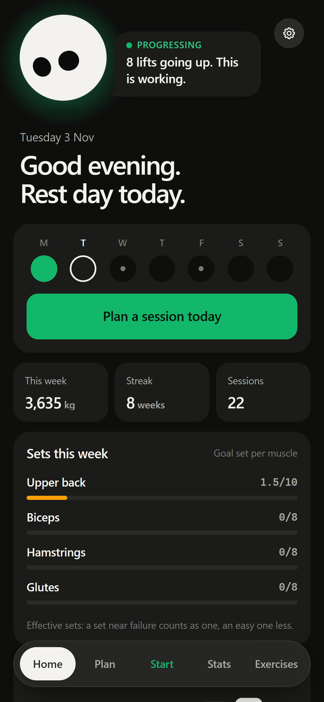
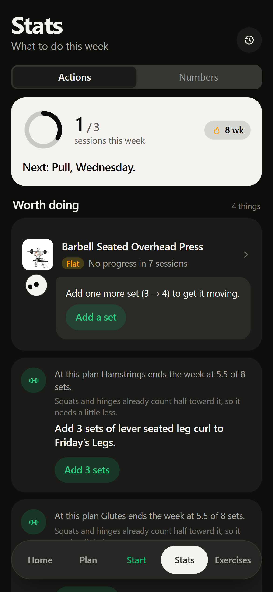
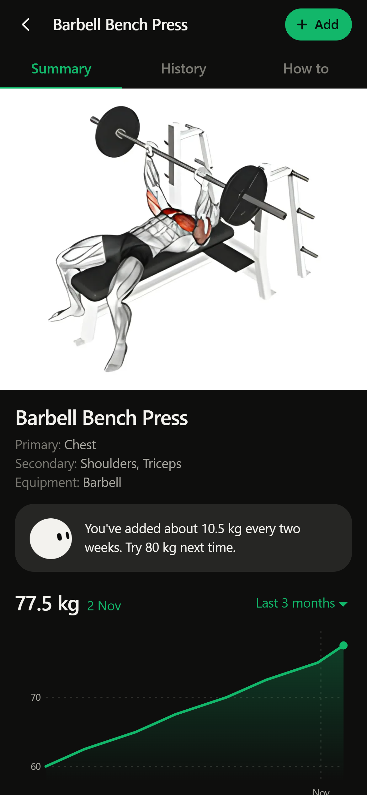
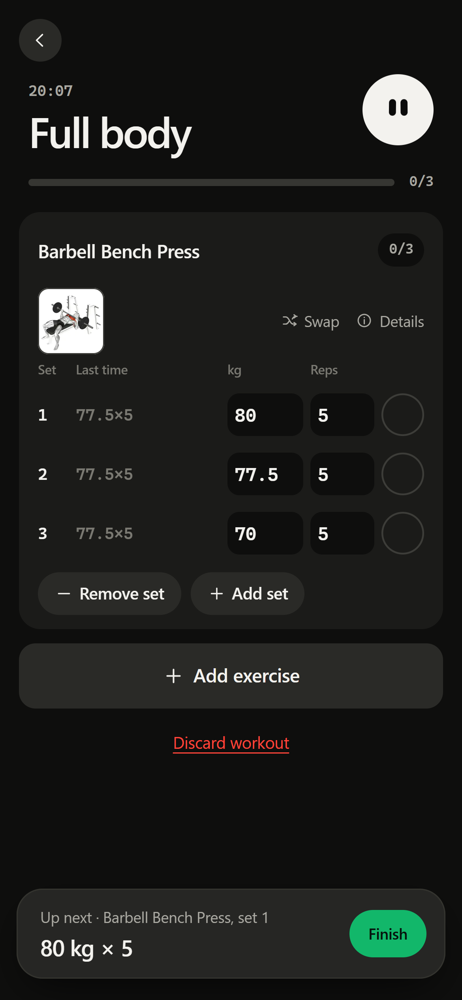
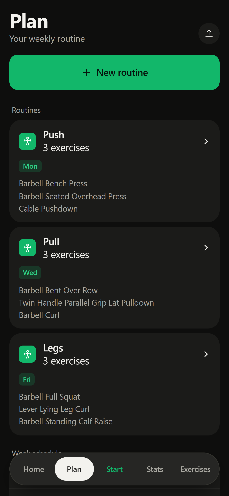

<div align="center">


# openGym

**A gym tracker with a coach that reads your training and tells you what to do next.**

Log your sets and Peek, the little orb on the Home screen, tells you whether you're
actually getting stronger, which lift has gone flat and which muscle your plan leaves short.
Every suggestion comes with its reason and one button to act on it.
Free, open source, no ads, no tracking.

<br>

### [▶ Try it in your browser](https://open-gym-lac.vercel.app)

<sub>No sign-up. Your data stays in that browser. Add it to your home screen and it works like an app.</sub>

<br>

[](https://open-gym-lac.vercel.app)
[](LICENSE)


[](https://github.com/juan1232-cmyk/openGym/commits/main)
[](https://github.com/juan1232-cmyk/openGym/stargazers)

</div>

<br>

<div align="center">
<table>
<tr>
<td align="center"><br><sub><b>Home</b>: Peek's verdict and your sets this week</sub></td>
<td align="center"><br><sub><b>Stats</b>: what's worth doing this week</sub></td>
<td align="center"><br><sub><b>Exercise</b>: your trend and the next weight</sub></td>
</tr>
<tr>
<td align="center"><br><sub><b>Workout</b>: last time's numbers beside each set</sub></td>
<td align="center"><br><sub><b>Plan</b>: routines and your week</sub></td>
<td></td>
</tr>
</table>
</div>

## Why another gym app

Most trackers are notebooks: they store what you lifted and leave you to work out whether
it's working. openGym tries to answer that question for you. It works through your log the way a
coach would, decides whether you're progressing, holding, slipping or stuck, and turns that
into something you can do this week, such as adding a set, swapping a lift, deloading or moving
a missed session.

It's also mine to learn on: this is my first real project, forked from an open-source tracker
and rebuilt around that coaching idea. More on that under [Credits](#credits).

## Meet Peek

Peek is the orb at the top of Home. It looks at the lifts you've trained in the last four weeks
and settles on one verdict:

| Verdict | When |
|---|---|
| **Progressing** | your main lifts are trending up |
| **Holding** | they're steady, within about 1% over two weeks |
| **Slipping** | they're trending down |
| **Stalled** | two or more planned lifts have missed their targets session after session |
| **Away** | nothing logged for 10+ days, so there's nothing to judge |

The verdict is deliberately boring: the same log always gives the same answer, and it reads the
same trend line the exercise page draws, so Home and the chart can't disagree. Peek only picks
*how* to say it. It also shows up on each exercise ("You've added about 10.5 kg every two weeks.
Try 80 kg next time."), and at the end of a workout to celebrate what went up.

## What it does for your progress

- 🎯 **Sets per muscle, every week.** Each muscle has a weekly goal (10 sets for chest, upper back
  and quads, 8 for most others, 6 for abs) along with the reason for that number. Squats and
  hinges count half toward hamstrings and glutes, and an easy set counts less than one taken near
  failure.
- ✅ **Stats that tell you what to do.** The *Actions* tab lists what's worth doing this week. A
  lift with no progress in 7 sessions gets "add one more set". A muscle the plan leaves short gets
  "add 3 sets of leg curls to Friday's Legs". A skipped day gets moved somewhere it fits. One tap
  applies the suggestion. The *Numbers* tab still has the charts, heatmap and PRs.
- 📈 **Progression that follows a rule.** Pick one per routine, override it per exercise: linear,
  **Greyskull LP** (AMRAP top set, 10% resets), double progression through a rep range, or adding
  time. Your weights are already set when the session opens, and every target says *why* it's
  that number. Missed reps never add weight, stalls lead to a deload, and bodyweight exercises
  progress in reps.
- 💪 **Estimated 1RM and PRs.** Per exercise, worked out from your best eligible set (it shows
  which one), with a PR badge on every set that beat your previous best.
- 🧍 **Two clear poses per exercise.** 1,324 exercises, each showing its two key positions as
  sharp upscaled illustrations, plus step-by-step instructions.

<details>
<summary><b>Everything else it does</b></summary>
<br>

- ▶️ **Guided workouts.** Starts today's session from your weekly plan, pre-fills last time's
  numbers, and has a rest timer. The screen stays awake while you train.
- 🗓️ **Reschedule a day** without touching your weekly plan.
- 🔗 **Supersets**, ⏱️ **timed exercises** (planks, hangs, carries) and 🏃 **cardio** (time + speed).
- ↔️ **Reps per side** for lunges and single-arm work. Bodyweight exercises have no weight
  column, and a dip belt counts as added weight.
- 🎚️ **Effort per set (optional)** as RIR or RPE, read back in Stats as an effort card and a
  hard-sets view of the muscle map.
- 🧠 **Muscle map.** Front and back, shaded by the work each muscle got this week, month or all
  time. It also previews what a routine hits while you build it.
- ⚖️ **Body weight** with a goal line, and a 🟩 GitHub-style **activity heatmap**.
- 🔧 **Filter the library by the equipment you own**, and add ✨ **your own exercises**.
- 📥 **Import** from FitNotes, Strong and Hevy, or body weight from Apple Health.
  📤 **Share a plan** as a small file or a printable PDF.
- 🌍 **12 languages** for the UI, with exercise instructions in 10 of them.
- 🎨 Light/dark theme and 8 accent colours.
- 📦 **Yours to keep.** One-tap JSON export/import and no telemetry.
- Self-hosted extras: 🔑 passkey sign-in synced across devices, 🔔 push notifications for rest
  timers and missed days, and an optional 🛠️ admin dashboard with invite-only signup.

</details>

## Try it

**In the browser:** [open-gym-lac.vercel.app](https://open-gym-lac.vercel.app). It runs in guest
mode, so everything is saved in that browser only. To keep it on your phone: **iPhone**, Safari →
Share → Add to Home Screen. **Android**, Chrome → ⋮ → Add to Home screen.

**With demo data:** [open-gym-lac.vercel.app/device.html](https://open-gym-lac.vercel.app/device.html)
shows the app inside a drawn iPhone, with buttons that load made-up training histories (Progressing,
Stalled, Away, a busy week, a workout in progress). It's the quickest way to see what Peek says
without logging a month of sessions. It replaces whatever that browser has saved.

## Run it yourself

The hosted demo has no server, so it can't sync. Running your own copy adds the backend: passkey
sign-in, sync across your phone and laptop, and push notifications.

**With Node** (20.19+ or 22.12+), in two terminals:

```bash
cd api && npm install && DATA_DIR=./data ORIGIN=http://localhost:5173 npm start   # backend on :3000
```

```bash
cd frontend && npm install && npm run dev               # app on http://localhost:5173
```

**With Docker**, which builds everything and serves it on one origin through nginx:

```bash
git clone https://github.com/juan1232-cmyk/openGym && cd openGym
cp .env.example .env
docker compose up -d --build                            # app on http://localhost:8080
```

The first Docker launch downloads the exercise GIFs and images (~140 MB) once. Plain `npm run dev`
skips them: the poses and thumbnails ship with the app, and only the animated GIFs are missing.

> Passkeys from your phone over the internet need an HTTPS domain, which is a two-line change in
> `.env`. See [docs/SELF_HOSTING.md](docs/SELF_HOSTING.md).

<details>
<summary><b>Configuration</b> (<code>.env</code>)</summary>
<br>

| Variable      | What it is                                              | Default                 |
|---------------|---------------------------------------------------------|-------------------------|
| `RP_ID`       | Hostname passkeys are bound to                          | `localhost`             |
| `ORIGIN`      | Full URL the app is served from                         | `http://localhost:8080` |
| `WEB_PORT`    | Host port for the web UI                                | `8080`                  |
| `RP_NAME`     | Name shown in the passkey prompt                        | `openGym`               |
| `ADMIN_UIDS`  | User ids that get the admin dashboard (comma-separated) | *(none)*                |
| `INVITE_ONLY` | Require an invite code to create a profile              | *(off)*                 |

Push notification keys are generated on first run and saved to `data/vapid.json`, so there's
nothing to set.

</details>

**Your data** lives in `data/`: `db.json` (profiles + public passkey keys), one
`state-<user>.json` per person (plan, workouts, body weight, settings) and `secret` (the
session-cookie key). Back up that folder and you've backed up everything. Passkey private keys
never leave your device.

## How it's built

```
 phone / laptop ──▶  web (nginx)  ── serves the React app
                        │
                        └─ /api ──▶  api (Node + WebAuthn) ──▶ data/*.json
```

- **frontend/**: React 19 + Vite, React Router and Zustand. That's the whole runtime. The full
  app state is one object in one store, saved to `localStorage` and synced to the server a moment
  after each change.
- **api/**: plain `node:http` with no framework and no database, just JSON files. Two dependencies
  (`@simplewebauthn/server` for passkeys, `web-push`).
- **The coaching is pure functions** in [`frontend/src/lib/`](frontend/src/lib): progression,
  1RM, Peek's verdict, weekly goals, the Actions suggestions. Each one has a test file beside
  it, because that arithmetic is where the real bugs were, and clicking through the UI never
  exercises it. Run the tests with `cd frontend && npm test`.

## Roadmap

- [x] Peek's progress verdict, weekly sets per muscle, Stats → Actions
- [x] Progression rules (linear, Greyskull LP, double progression) with stalls and deloads
- [x] Estimated 1RM, PR badges, importers from FitNotes / Strong / Hevy
- [ ] **Coming soon:** accounts + sync on the hosted version, so the browser demo stops being
      device-only
- [ ] Percentage / training-max programs (5/3/1-style) on top of the progression engine
- [ ] More starter plans (upper/lower, full-body, 5×5)
- [ ] Body measurements (waist, arms…) alongside weight
- [ ] Plate calculator and per-exercise notes

Found a bug or have an idea? [Open an issue](https://github.com/juan1232-cmyk/openGym/issues).
**And if you like where this is going, a ⭐ helps more people find it.**

## Credits

openGym started as a fork of the open-source **openGym** tracker by Duarte Santos. The original
repository is no longer online. The active copy lives at
[arvids-unavailable/openGym](https://github.com/arvids-unavailable/openGym). The tracking core,
importers, passkey backend and translations come from there. Peek, the progress verdict, weekly
goals, Stats → Actions, the exercise pages and the new design were added in this fork.

Exercise data and illustrations come from
[hasaneyldrm/exercises-dataset](https://github.com/hasaneyldrm/exercises-dataset) and keep their
own terms (reportedly non-commercial). See [NOTICE.md](NOTICE.md).

## License

[GNU AGPL v3.0](LICENSE). You can use, modify and share it. If you run a modified version as a
network service for other people, you have to publish that version's source under the same licence.
